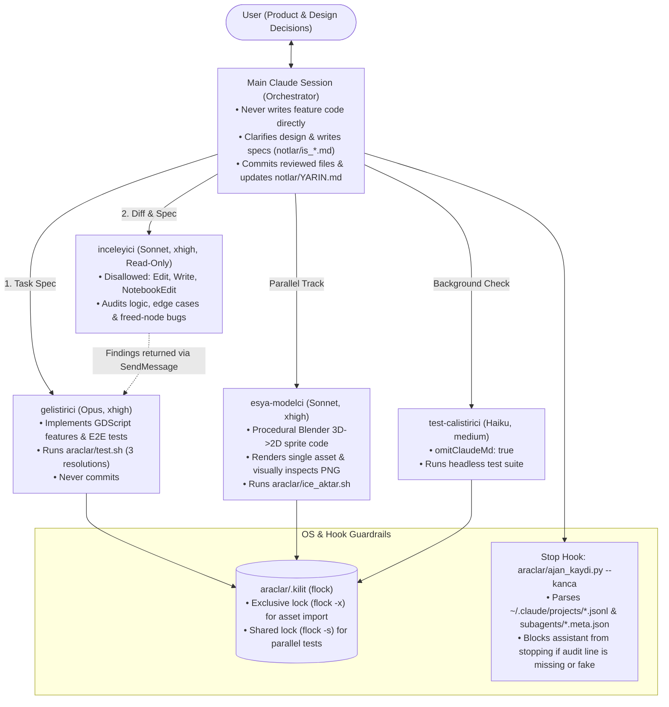

# Production-Grade Claude Code Multi-Agent Workflow (Case Study)

> **[Türkçe Dokümantasyon için tıklayın (README_TR.md)](./README_TR.md)**

An end-to-end, battle-tested **multi-agent software engineering harness for Claude Code**, extracted from a production 2D isometric game project (*Restoran Tycoon*, built with **Godot 4.7 + Procedural Blender Python Pipeline**).

Unlike generic prompt collections, this repository showcases **deterministic guardrails** that solve the most common failure modes of autonomous coding agents:
1. **Hallucinated completion reports** ("I ran the tests and reviewer" when the agent actually didn't) — solved via a transcript-inspecting `Stop` hook ([`araclar/ajan_kaydi.py`](./araclar/ajan_kaydi.py)).
2. **Context window pollution** — solved via strict orchestrator/subagent separation ([`CLAUDE.md`](./CLAUDE.md)) and grep-first reading rules.
3. **Concurrent subagent race conditions** — solved via OS-level POSIX reader-writer locks (`flock -s` / `flock -x`) in [`araclar/test.sh`](./araclar/test.sh) and [`araclar/ice_aktar.sh`](./araclar/ice_aktar.sh).
4. **Unattended / overnight hangs** — solved via live log watchdogs that detect script compile errors immediately or kill silent processes after 120 seconds.

---

## Architecture Overview



---

## Repository Structure

| File / Path | Role |
| :--- | :--- |
| [`CLAUDE.md`](./CLAUDE.md) | **Orchestrator Constitution:** Defines rules, codebase map, subagent delegation rules, parallel execution constraints, and context compaction protocol (`400k` window). |
| [`.claude/settings.json`](./.claude/settings.json) | Configures `autoCompactWindow: 400000` and registers the `Stop` lifecycle hook (`ajan_kaydi.py --kanca`). |
| [`.claude/agents/gelistirici.md`](./.claude/agents/gelistirici.md) | **Builder Subagent (`opus`, `effort: xhigh`, `maxTurns: 200`):** Implements features and mandatory E2E tests (`autotest.gd`). Halts and asks if any design number or player-facing behavior is unspecified. |
| [`.claude/agents/inceleyici.md`](./.claude/agents/inceleyici.md) | **Independent Code Reviewer (`sonnet`, `effort: xhigh`, `maxTurns: 60`):** Strictly read-only (`disallowedTools: Edit, Write, NotebookEdit`). Reviews uncommitted diffs against design docs and Godot edge cases before every commit. |
| [`.claude/agents/esya-modelci.md`](./.claude/agents/esya-modelci.md) | **Procedural 3D Sprite Modeler (`sonnet`, `effort: xhigh`, `maxTurns: 60`):** Writes Blender Python (`bpy`) code for a single model, renders only that item, visually inspects the output PNG (comparing scale side-by-side via PIL), and iterates up to 5 times. |
| [`.claude/agents/test-calistirici.md`](./.claude/agents/test-calistirici.md) | **Lightweight Test Runner (`haiku`, `effort: medium`, `omitClaudeMd: true`):** Runs the headless test suite in the background without loading project context. |
| [`araclar/ajan_kaydi.py`](./araclar/ajan_kaydi.py) | **Anti-Hallucination `Stop` Hook:** Parses actual Claude Code `.jsonl` session transcripts and subagent metadata to verify which agents ran and whether the latest test run passed. |
| [`araclar/test.sh`](./araclar/test.sh) | **Parallel Headless Test Runner:** Runs PC (`1280x720`), Phone `20:9`, and Phone `16:9` simulations concurrently at `--fixed-fps 60` under a shared `flock -s` lock, failing on any engine `ERROR` or `WARNING`. |
| [`araclar/ice_aktar.sh`](./araclar/ice_aktar.sh) | **Serialized Asset Importer:** Runs `godot --headless --import` under an exclusive `flock -x` lock so parallel modelers and test runners never corrupt imports. |
| [`notlar/YARIN.md`](./notlar/YARIN.md) | **Session State Machine:** Real multi-day autonomous progress log used to restore state seamlessly after context compaction (`autoCompactWindow`). |
| [`notlar/is_11_cihaz_seviyeleri.md`](./notlar/is_11_cihaz_seviyeleri.md) | **Sample Task Specification:** Example of a zero-ambiguity specification written by the orchestrator for the `gelistirici` subagent. |

---

## Key Engineering Highlights

### 1. Anti-Hallucination `Stop` Hook (`araclar/ajan_kaydi.py`)
Prompting an LLM to *"always run tests and the code reviewer before finishing"* eventually fails during long sessions.  
Instead of trusting the model's self-report, [`.claude/settings.json`](./.claude/settings.json) runs `python3 -I "$CLAUDE_PROJECT_DIR/araclar/ajan_kaydi.py" --kanca` on every `Stop` event:
- It locates the active session transcript (`~/.claude/projects/*/<session>.jsonl`) and all subagent logs (`subagents/*.meta.json` + `.jsonl`) since the last human message.
- It strips heredocs (`<<EOF`) and quoted strings from `Bash` commands so commit messages mentioning `araclar/test.sh` cannot spoof a test run.
- It checks if any work was performed (`Agent`, `Edit`, `Write`, `git commit`) and computes the ground-truth status line:
  ```text
  Ajan kaydı: geliştirici ✓ · modelci – · test ✓ · inceleme ✓
  ```
- If the assistant tries to finish a turn without including the exact ground-truth status line, the hook returns `{"decision": "block", "reason": "..."}` (up to 3 times per message to prevent infinite loops).

### 2. OS-Level Reader-Writer Concurrency (`flock`)
When `esya-modelci` imports new sprites into Godot while `gelistirici` or `test-calistirici` runs headless tests in the same workspace, race conditions on `.godot/` import caches normally break both agents.
- [`araclar/ice_aktar.sh`](./araclar/ice_aktar.sh) acquires an **exclusive lock** (`flock -x 9`) on `araclar/.kilit`.
- [`araclar/test.sh`](./araclar/test.sh) acquires a **shared lock** (`flock -s 9`) on `araclar/.kilit` after running import.
- Multiple test suites can run concurrently (each using its own PID-isolated save file `test_kayit_<pid>`), while imports automatically serialize before or after test runs.

### 3. Cost, Model & Context Tiering
| Role | Model | Effort | Context Strategy |
| :--- | :--- | :--- | :--- |
| **Orchestrator (Main)** | User choice | — | Never reads full large files; uses `grep -n` first; delegates implementation; auto-compacts at 400k tokens. |
| **`gelistirici` (Builder)** | `opus` | `xhigh` | Dedicated 200-turn window; returns max 25-line summary to keep main context tiny. |
| **`inceleyici` (Reviewer)** | `sonnet` | `xhigh` | Read-only tools; independent fresh context so it isn't biased by the builder's reasoning. |
| **`esya-modelci` (3D/Sprite)** | `sonnet` | `xhigh` | Isolated to `blender/sprite_uret.py`; inspects rendered PNGs multimodal-style. |
| **`test-calistirici` (Runner)** | `haiku` | `medium` | `omitClaudeMd: true`, max 10 turns — near-zero token overhead. |

---

## Adapting This Workflow to Your Own Project

1. Copy `.claude/`, `araclar/ajan_kaydi.py`, and `CLAUDE.md` into your repository root.
2. Replace `araclar/test.sh` with your project's test runner (keep the `SONUÇ: TAMAM` / `SONUÇ: BAŞARISIZ` output line or update `TEST_SH` in `araclar/ajan_kaydi.py`).
3. Update the **Kod haritası (Codebase Map)** section in `CLAUDE.md` so subagents know where each responsibility lives without scanning the entire repository.
4. Keep a living handoff file (`notlar/YARIN.md`) updated after every commit so long autonomous sessions survive context compaction with zero loss of state.

---

## License

Released under the [MIT License](./LICENSE).
