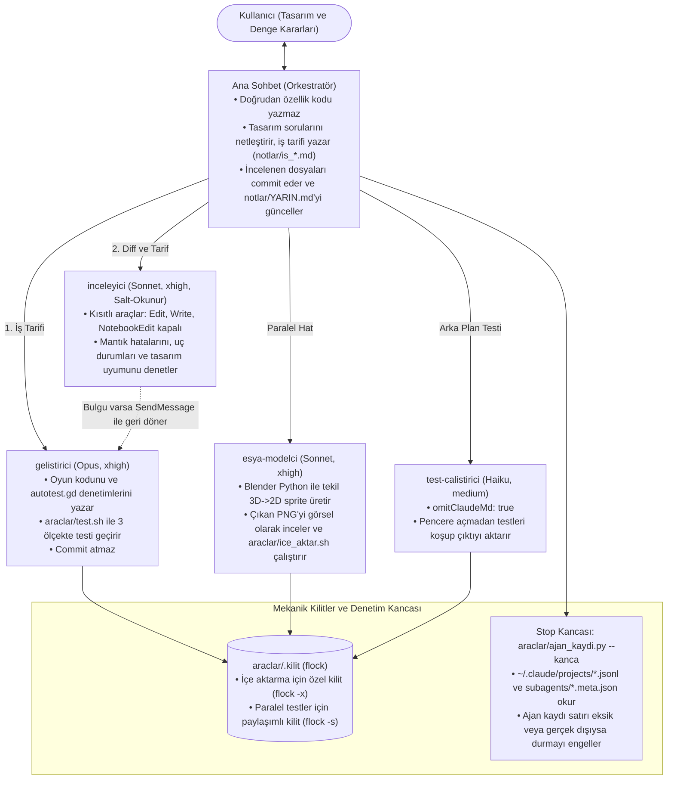

# Claude Code Çoklu Ajan İş Akışı ve Orkestrasyon Mimarisi (Vaka Analizi)

> **[Click here for the English Documentation (README.md)](./README.md)**

Bu repo, **Godot 4.7** ve **Blender Python (`bpy`)** ile geliştirilen 2D izometrik bir restoran yönetim oyunu (*Restoran Tycoon*) projesinden ayıklanmış, sahada test edilmiş **üretim seviyesinde (production-grade) Claude Code çoklu ajan iş akışını** içerir.

> [!IMPORTANT]
> **Bu Reponun Amacı ve Kapsamı (Önemli Not):**
> - **Tak-Çalıştır Paket Değil, Mimari Referans / Fikir Verme Amaçlıdır:** Bu repo, gerçek bir oyun projesinde kullanılan ajan iş akışını, kancaları (hooks) ve kilit script'lerini **fikir vermesi ve referans olması** amacıyla paylaşır. Oyunun kendi kaynak kodları (`oyun/`, `blender/sprite_uret.py` ve `tasarim/`) bu repoya dahil edilmemiştir.
> - **Çapraz Platform Desteği (Windows, macOS ve Linux):** Hem Bash script'leri (`araclar/test.sh`, `araclar/ice_aktar.sh`) hem de dış komuta ihtiyaç duymayan saf Python karşılıkları (`araclar/test.py`, `araclar/ice_aktar.py`) mevcuttur. macOS ve Windows (Git Bash / PowerShell) ortamlarında Python sürümleri (`fcntl.flock` / `msvcrt.locking`) doğrudan çalışır.
> - **Doğrudan Kullanım Şartları:** Ajan tanımları (`.claude/agents/*.md`) ve araçlar orijinal projedeki dosya yollarına ve ajan isimlerine göre yazılmıştır. Kendi projenizde doğrudan kullanmak için bu dosyaları kendi teknoloji yığınınıza ve test komutlarınıza göre uyarlamanız gerekir.

Genel amaçlı hazır prompt şablonlarından farklı olarak bu mimari, otonom kodlama ajanlarının en sık düştüğü **4 temel mühendislik sorununu mekanik bariyerlerle** çözer:
1. **Halüsinasyon Raporlama:** Ajanın testi veya kod incelemesini çalıştırmadığı halde *"çalıştırdım ve geçti"* demesi → `.jsonl` oturum kayıtlarını doğrudan denetleyen `Stop` kancası ([`araclar/ajan_kaydi.py`](./araclar/ajan_kaydi.py)) ile engellenir.
2. **Bağlam (Context) Şişmesi:** Ana sohbetin büyük dosyaları okuyup bağlamı doldurması → Ana sohbetin yalnızca orkestratör olarak çalışması ([`CLAUDE.md`](./CLAUDE.md)), `grep -n` kuralı ve alt ajanların en fazla 25-30 satırlık özetle dönmesiyle çözülür.
3. **Paralel Çalışma Çakışmaları (Race Conditions):** Aynı anda çalışan modelci ve geliştirici ajanların Godot içe aktarma (`.godot/`) veya kayıt dosyalarını bozması → İşletim sistemi düzeyinde `flock` okuyucu-yazıcı kilitleri ([`araclar/ice_aktar.sh`](./araclar/ice_aktar.sh) ve [`araclar/test.sh`](./araclar/test.sh)) ile çözülür.
4. **İnsansız (Unattended) Çalışmada Takılma:** Kullanıcı bilgisayar başında değilken bozuk bir betiğin veya sonsuz döngünün testi kilitlemesi → Canlı log izleyicisinin derleme hatasını anında, sessiz kalan süreci ise 120 saniyede otomatik kesmesiyle çözülür.

---

## Mimari Akış Şeması



---

## Klasör ve Dosya Yapısı

| Dosya / Klasör | Açıklama |
| :--- | :--- |
| [`CLAUDE.md`](./CLAUDE.md) | **Orkestrasyon Anayasası:** Kuralları, kod haritasını, hangi işin hangi alt ajana gideceğini, paralel çalışma sınırlarını ve bağlam özetleme (`400k` token) düzenini tanımlar. |
| [`.claude/settings.json`](./.claude/settings.json) | `autoCompactWindow: 400000` ayarını ve her tur sonunda çalışan `Stop` kancasını (`ajan_kaydi.py --kanca`) tanımlar. |
| [`.claude/agents/gelistirici.md`](./.claude/agents/gelistirici.md) | **Geliştirici Ajan (`opus`, `effort: xhigh`, `maxTurns: 200`):** Tarifi net özellikleri ve otomatik testleri uygular. Tasarım kararı uydurmaz; belirsizlik varsa durup sorar. |
| [`.claude/agents/inceleyici.md`](./.claude/agents/inceleyici.md) | **Bağımsız Kod İnceleyici (`sonnet`, `effort: xhigh`, `maxTurns: 60`):** Yazma araçları kapalıdır (`disallowedTools: Edit, Write, NotebookEdit`). Her geliştirici işinden sonra, commit'ten önce `git diff` ve tasarım belgelerini karşılaştırır. |
| [`.claude/agents/esya-modelci.md`](./.claude/agents/esya-modelci.md) | **Prosedürel Sprite Modelcisi (`sonnet`, `effort: xhigh`, `maxTurns: 60`):** `blender/sprite_uret.py` içinde sadece tek bir modeli kodlar, render alır, çıkan PNG'ye bizzat bakarak oran/çizgi kontrolü yapar. |
| [`.claude/agents/test-calistirici.md`](./.claude/agents/test-calistirici.md) | **Hafif Test Koşucu (`haiku`, `effort: medium`, `omitClaudeMd: true`):** Ana sohbet başka bir işle ilgilenirken arka planda düşük maliyetle testleri çalıştırır. |
| [`araclar/ajan_kaydi.py`](./araclar/ajan_kaydi.py) | **Oturum Kaydı Doğrulayıcı (`Stop` Kancası - Windows/macOS/Linux):** Claude'un kendi beyanına güvenmez; doğrudan `.jsonl` oturum kayıtlarını okuyarak o turda hangi ajanların çalıştığını ve son testin geçip geçmediğini doğrular. |
| [`araclar/test.py`](./araclar/test.py) / [`test.sh`](./araclar/test.sh) | **Çapraz Platform Paralel Headless Test Script'i:** Önce içe aktarmayı yapar, ardından PC, 20:9 ve 16:9 telefon ölçeklerindeki testleri `--fixed-fps 60` ile aynı anda koşar (~35 sn). Windows, macOS ve Linux'ta çalışır. |
| [`araclar/ice_aktar.py`](./araclar/ice_aktar.py) / [`ice_aktar.sh`](./araclar/ice_aktar.sh) | **Çapraz Platform Kilitli Varlık İçe Aktarıcı:** Dosya kilidi (`fcntl.flock` / `msvcrt.locking`) altında Godot `--import` çalıştırır; testlerle çakışmayı önler. |
| [`notlar/YARIN.md`](./notlar/YARIN.md) | **Durum Makinesi / Devir Teslim Notları:** Bağlam 400 bin token'a ulaşıp otomatik özetlendiğinde veya yeni oturuma geçildiğinde kayıpsız devam etmeyi sağlayan gerçek oturum günlüğü. |
| [`notlar/is_11_cihaz_seviyeleri.md`](./notlar/is_11_cihaz_seviyeleri.md) | **Örnek Görev Tarifi:** Ana sohbetin `gelistirici` ajanına gönderdiği, tasarım belgelerine referanslı ve kabul ölçütleri netleştirilmiş gerçek bir görev spesifikasyonu. |

---

## Öne Çıkan Mühendislik Çözümleri

### 1. Beyana Değil Kayıtlara Dayalı `Stop` Kancası (`araclar/ajan_kaydi.py`)
İş yapılan (dosya değişen, alt ajan çalışan veya commit atılan) her turun sonunda ana sohbet şu satırı eklemek zorundadır:
```text
Ajan kaydı: geliştirici ✓ · modelci – · test ✓ · inceleme ✓
```
- [`araclar/ajan_kaydi.py`](./araclar/ajan_kaydi.py), `~/.claude/projects/` altındaki gerçek `.jsonl` kayıtlarını ve `subagents/*.meta.json` dosyalarını tarar.
- `Bash` komutlarındaki heredoc (`<<EOF`) ve tırnak içi metinleri temizler (böylece commit mesajında `araclar/test.sh` geçmesi test çalıştı olarak algılanmaz).
- Eğer son mesajda bu satır yoksa veya Claude'un yazdığı satır gerçek oturum kayıtlarıyla uyuşmuyorsa `{"decision": "block"}` döndürerek Claude'un durmasını engeller ve doğru satırı verir.

### 2. İşletim Sistemi Kilitleriyle (`flock`) Güvenli Paralellik
- `esya-modelci` ile geliştirme hattı (`gelistirici` → `inceleyici` → `commit`) farklı dosyalara dokunduğu için aynı anda çalışabilir.
- [`araclar/ice_aktar.sh`](./araclar/ice_aktar.sh) `araclar/.kilit` üzerinde **özel kilit (`flock -x`)**, [`araclar/test.sh`](./araclar/test.sh) ise **paylaşımlı kilit (`flock -s`)** alır. Böylece içe aktarma sürerken testler bekler, testler sürerken içe aktarma bekler; ancak birden fazla test kendi PID bazlı kayıt dosyasıyla (`test_kayit_<pid>`) birbirini bozmadan aynı anda çalışabilir.

### 3. Model, Efor ve Bağlam Optimizasyonu
- **Mimari ve Kodlama:** `gelistirici` için `opus` (`effort: xhigh`).
- **Bağımsız Denetim ve Görsel Modelleme:** `inceleyici` ve `esya-modelci` için `sonnet` (`effort: xhigh`).
- **Mekanik Test Koşumu:** `test-calistirici` için `haiku` (`effort: medium`, `omitClaudeMd: true`).
- **Büyük Dosya Kuralı:** Büyük dosyaların baştan sona okunması yasaktır; önce `grep -n` ile ilgili fonksiyon bulunur ve yalnızca o aralık okunur.

---

## Doğrudan Kullanım Şartları ve Bilinen Sınırlılıklar

Bu akışı kendi projenize uyarlarken şu teknik şartları göz önünde bulundurmalısınız:

1. **Tek Başına Çalıştırılamaz:** Oyun klasörü (`oyun/`) ve Blender script'i (`blender/sprite_uret.py`) bu repoda yer almadığı için `araclar/test.py` (`test.sh`) veya `araclar/ice_aktar.py` (`ice_aktar.sh`) doğrudan çalıştırıldığında hata verir; kendi test ve derleme komutlarınızla değiştirilmelidir.
2. **Projeye Özgü Sabit İsimler (Hardcoded):** [`araclar/ajan_kaydi.py`](./araclar/ajan_kaydi.py) içinde ajan adları (`gelistirici`, `esya-modelci`, `inceleyici`) ve test başarı metni (`SONUÇ: TAMAM`) sabittir. Kendi ajan isimlerinizi ve test aracınızı (`pytest`, `npm test` vb.) kullanırken bu sabitleri güncellemeniz gerekir.
3. **Claude Code İç Kayıt Formatına Bağımlılık:** `ajan_kaydi.py`, `~/.claude/projects/*/<oturum>.jsonl` kayıtlarını doğrudan okur. Anthropic resmi bir şema garantisi vermediği için gelecekteki Claude Code CLI güncellemelerinde log yapısı değişirse betiğin güncellenmesi gerekebilir.
4. **Ortak Çalışma Dizini (Shared Working Tree) Sınırı:** `esya-modelci` ve `gelistirici` ajanlarının aynı klasörde paralel çalışabilmesi, tamamen farklı dosyalara (`blender/` vs `oyun/scripts/`) dokunmalarına dayanır. Aynı dosyalara dokunabilecek paralel ajanlar için `git worktree` izolasyonu kullanılmalıdır.
5. **Süreç Kontrolü vs. İçerik Kontrolü:** `Stop` kancası o turda `inceleyici` ajanının ve testin çalışıp çalışmadığını denetler; ancak inceleyicinin bulduğu her bulgunun anlamsal olarak çözülüp çözülmediğini karar olarak ana sohbete bırakır.

---

## Lisans

Bu proje [MIT Lisansı](./LICENSE) altında açık kaynak olarak paylaşılmıştır.
